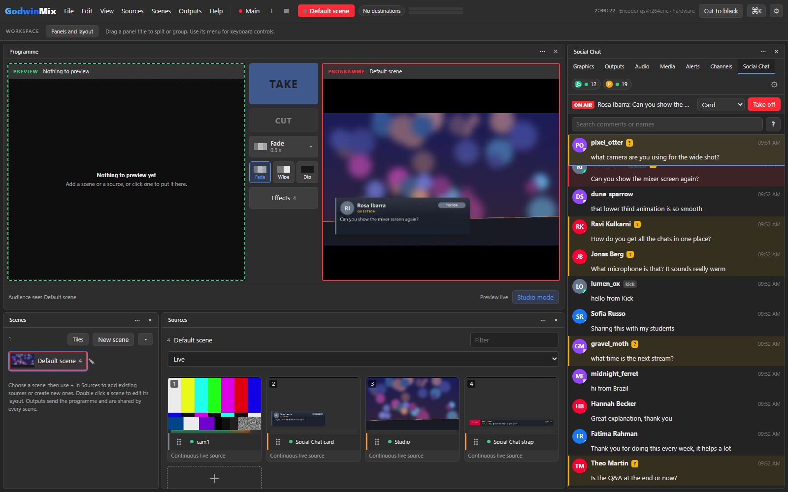
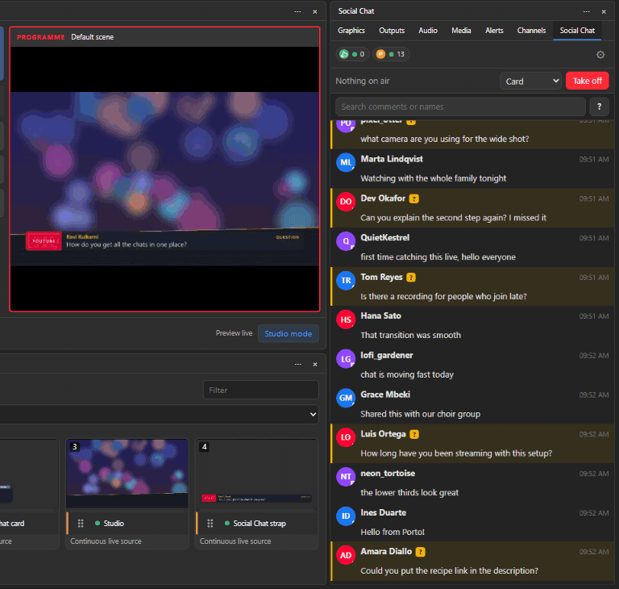
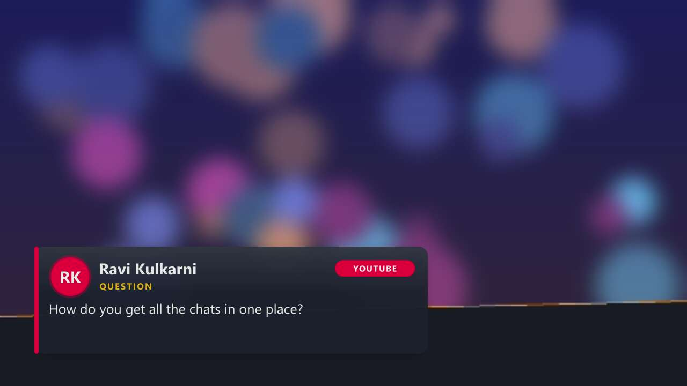

# Social Chat for GodwinMix

Live comments from YouTube, Twitch, Facebook and anything that can POST a
webhook, in one list inside the [GodwinMix](https://github.com/psmux/GodwinMix)
mixer. Comments from every platform are merged in time order and each one
appears once. You can filter by platform, search, pin a comment, hide one,
ban an author locally, and see questions picked out in their own colour. One
click puts a comment on the programme as a card or a lower third, and one
more takes it off.



It is a plugin with two parts. A small Python service reads the platforms,
and a panel shows the list in the mixer's page. The service uses nothing but
the Python standard library, so there is nothing to install beyond Python 3.10
or newer, which `gmx plugin add` already looks for.

## What it can read

| Platform | What you need | How it reads | Limits |
|---|---|---|---|
| YouTube | an API key, and the stream's address | polls the YouTube Data API v3 `liveChatMessages` | 10,000 quota units a day per Google project; see below |
| Twitch | only the channel name | anonymous read only chat over TLS, no account | none worth worrying about; it joins at most 20 channels |
| Facebook | a Page access token | the `live_comments` stream, falling back to polling | Facebook's rate limits for the token; it backs off by itself |
| Anything else | a tool that can POST JSON | the built in webhook on this machine | 256 KB and 200 comments a request |
| X (Twitter) | a paid X API plan | not built: a stub that says so | see [X](#x-twitter) |

## Install

From the mixer's Plugins page, or from a terminal:

```sh
gmx plugin add psmux/godwinmix-social-chat
```

From a copy on disk it is the same command with the folder:

```sh
gmx plugin add ./godwinmix-social-chat
```

Reload the mixer's page. **Social Chat** appears as a tab beside Graphics,
Outputs and the others. Open it, press the gear, and fill in the platforms you
use. Nothing connects until you do.

To try the panel and the on air card before any chat is connected, open
Settings and tick **Send made up comments for a rehearsal** under Practice.
It sends a comment from an invented person every few seconds. Turn it off
before the show.

## Setting up each platform

### Twitch

Type the channel name in **Twitch channels**, for example `ourchannel`, and
press Save. Several channels go in one line, separated by commas. That is all:
Twitch lets anyone read a public chat without an account, and that is how
this reads it.

### YouTube

You need an API key from a Google Cloud project. It is free.

1. Go to <https://console.cloud.google.com/> and sign in with any Google
   account. It does not have to be the channel's.
2. Make a project: the project menu at the top, then **New project**. Any
   name will do.
3. Open **APIs and services**, then **Library**. Search for
   **YouTube Data API v3**, open it and press **Enable**.
4. Open **APIs and services**, then **Credentials**. Press **Create
   credentials** and choose **API key**. Copy the key.
5. Press **Edit API key** on the new key. Under **API restrictions** choose
   **Restrict key** and tick only **YouTube Data API v3**. Save.
6. In Social Chat's Settings paste the key into **API key**, and the stream's
   address into **Stream address**, for example
   `https://www.youtube.com/watch?v=dQw4w9WgXcQ`. Press Save.

The stream's own address is the cheapest thing to give it. A channel's
`@handle` works too, but finding which video is live on a channel costs 100
quota units each time it connects, against 1 unit for a stream address.

**Quota.** A Google project gets 10,000 units a day, and reading the chat
costs 5 units a read. Social Chat reads no faster than YouTube asks
(`pollingIntervalMillis` in each answer, usually a few seconds), and never
faster than **Read the chat no faster than every** in Settings, 5 seconds by
default. At one read every 5 seconds a day's quota lasts about 2.8 hours of
chat; at 10 seconds about 5.5 hours. A longer show needs a slower read or
more quota, which Google grants through the quota extension form linked from
the API's **Quotas** page. The quota resets at midnight Pacific time. When it
runs out the panel says so and tries again every half hour.

**OAuth, only if you need it.** An API key reads any public or unlisted live
chat. OAuth is for two other cases: a private stream, and leaving the stream
address empty so the plugin finds whatever your own channel is streaming.

1. In the same Cloud project, open **APIs and services**, then **OAuth
   consent screen**, and set it up for **External** users with yourself as a
   test user.
2. Under **Credentials**, **Create credentials**, **OAuth client ID**, type
   **Web application**. Add
   `https://developers.google.com/oauthplayground` as an authorised redirect
   URI. Copy the client ID and the client secret.
3. Open <https://developers.google.com/oauthplayground>. Press the gear, tick
   **Use your own OAuth credentials** and paste the two values.
4. In the list on the left type the scope
   `https://www.googleapis.com/auth/youtube.readonly`, press **Authorize
   APIs**, sign in as the channel's owner, then press **Exchange
   authorization code for tokens**.
5. Paste the client ID, the client secret and the **refresh token** into
   Settings. Social Chat renews the short lived access token itself from then
   on.

### Facebook

Facebook needs a Page access token for the Page that is live.

1. Go to <https://developers.facebook.com/apps> and create an app of the
   **Business** type. The name does not matter.
2. Open the Graph API Explorer at
   <https://developers.facebook.com/tools/explorer/>. Pick your app at the
   top right.
3. Under **Permissions** add `pages_show_list`, `pages_read_engagement` and
   `pages_read_user_content`.
4. Under **User or Page** choose **Get Page access token**, approve the Page
   when Facebook asks, then choose the Page in the same menu. Press
   **Generate access token** and copy it.
5. Paste it into **Page access token** in Settings and press Save. Leave
   **Live video address** empty and Social Chat finds whatever the Page is
   streaming. Paste the live video's address there to read one video in
   particular.

A token made this way lasts about an hour. For one that lasts, open the
Access Token Debugger at <https://developers.facebook.com/tools/debug/accesstoken/>,
paste the user token from step 4 and press **Extend Access Token**, then ask
the Explorer for the Page token again with the extended user token selected.
A Page token made from a long lived user token does not expire on a timer.

Without `pages_read_user_content` Facebook leaves out who wrote each comment,
and the list shows "Facebook user".

### The webhook, for every other platform

Tick **Accept comments POSTed as JSON** in Settings. Social Chat then listens
on `http://127.0.0.1:8790/comments`, on this machine only, unless you change
the address. Anything that can send an HTTP request can put comments in the
list: a chat relay, Streamer.bot, a script, another plugin.

```sh
curl -X POST http://127.0.0.1:8790/comments \
  -H 'Content-Type: application/json' \
  -H 'X-Social-Chat-Secret: change-me' \
  -d '{"platform": "tiktok", "id": "7301", "author": "Sam", "text": "hello from TikTok"}'
```

Send one comment, a list of them, or `{"comments": [...]}`. Each needs the
words and who wrote them; the common names for each are read, so most tools
work without changes. Every field is listed in
[docs/webhook.md](docs/webhook.md). Set a **Secret** before you open the
webhook to the network, by changing **Listen on address** to `0.0.0.0`.

### X (Twitter)

Reading replies to a live post needs X's filtered stream or search API, and
neither is in X's free tier: they need the paid Basic plan or above. Social
Chat does not pretend otherwise. Its X adapter is a stub that says this when
switched on, and [docs/adapters.md](docs/adapters.md) describes what a working
one would do for anyone with a paid key. Until then, a tool that already
reads X can send the replies in through the webhook.

## Putting a comment on air

Hover over a comment and press **On air**. The comment goes onto the scene
that is on the programme, in the style chosen at the top of the panel:

* **Card**: the person's picture (or their initials), their name, the
  platform and up to three lines, low on the left.
* **Lower third**: one line across the bottom, with the name and platform.

Press **Take off** to take it off. Putting another comment up while one is on
air takes the first one out and brings the new one in.



It is done with the mixer's own public methods, the same ones any client or
agent uses: the graphic is an SVG template source called `social-chat-card`
(or `social-chat-strap`), and it is shown and hidden as an item on the
programme scene, with a slide in and a fade out. Because it is an ordinary
source, you can move it, resize it, or put it on other scenes from the
composer as you like.

The colours follow the station's `[graphics]` colours (`accent`, `panel` and
`text` in the mixer's config) when they are set. To change the design, copy
`graphics/comment-card.svg` from the plugin, edit it, and save it as your own
template in the mixer; the fields it takes are listed at the top of the file.



## Moderating, locally

* **Pin** keeps a comment at the top of the panel, even after it scrolls away.
* **Hide** takes one comment out of the list. A box in Settings shows hidden
  ones again, faded.
* **Ban** removes everything an author has written from the list and drops
  whatever they write next. It takes two presses, to avoid accidents.

All three change this mixer's list only. Nothing is deleted or banned on
YouTube, Twitch or Facebook, and nobody is told. Unban someone in Settings.

When a moderator deletes a message or bans someone on YouTube or Twitch, it
leaves the list here too.

## Questions

A comment that asks something (it has a question mark, or starts with a word
such as what, how, can or is) is marked with a **?** and a stripe in the
question colour, which you can change in Settings. The **?** button beside
the search box shows questions only.

## Privacy

Nothing leaves this machine except the requests to the platforms you set up:
YouTube's API, Twitch's chat server, Facebook's Graph API, and the platforms'
own picture servers for profile pictures. There is no telemetry, no account
with us, and no server of ours in between.

Keys and tokens:

* are typed into the panel's Settings and sealed in the page before they are
  sent to the plugin, because the mixer keeps a log of every call made to a
  plugin. That log holds only ciphertext that nothing can open once the
  plugin process has stopped;
* are kept in `plugin-data/social-chat/settings.json` under the mixer's
  folder for your user (`~/.godwinmix` unless `GODWINMIX_HOME` says
  otherwise), encrypted for your Windows account with DPAPI on Windows, and
  readable by your user only on macOS and Linux;
* are never written to a log and never shown back whole. Settings shows
  "stored, ending 9xQk" at most.

Bans are kept beside the settings in `moderation.json`. Comments are kept in
memory only, the last 500 by default, and are gone when the mixer stops.

## Connection states

Each platform shows a dot and a count at the top of the panel. A platform
that is not connected also shows a line saying why and what to do next.

| State | Meaning |
|---|---|
| connected | reading comments |
| connecting | opening the connection |
| waiting | set up correctly, but there is nothing to read yet, such as a stream that has not started. It checks again by itself |
| not connected | it tried and failed. The line under it says what to change |
| not available | this platform cannot work here, such as X without a paid plan |
| off | not set up |

## For agents

The plugin's tools are reachable through the mixer's `tool.call` and over MCP
as `gmx_social-chat_<tool>`: `comments`, `status`, `settings`,
`save_settings`, `reconnect`, `pin`, `hide`, `ban`, `card_fields`,
`card_off`, `avatars` and `test_comment`. `skills/chat/SKILL.md` tells an
agent how to read the chat and put a comment on air. A key cannot be set
through `save_settings` as plain text; it has to come through the panel.

## Known gaps in GodwinMix 0.3.9

These are the mixer's, not the plugin's, and the plugin works around each:

* The mixer's page looks for a plugin's panel in `plugins/<name>/ui/`, but
  `gmx plugin add` installs into `plugins/<name>/<version>/`. Social Chat
  copies its `ui/` folder up one level when it starts, so the panel appears.
* A key typed into the mixer's own plugin settings form is sealed by the
  mixer and never handed to the plugin. Use the panel's Settings instead.
  A key written into `[plugins.social-chat]` in the mixer's config file does
  reach the plugin, as plain text in that file.
* Every `tool.call` goes into the mixer's session log, even a read. The panel
  asks for new comments with a long poll, about one call every one to three
  seconds while it is open, and none when it is closed.
* On Windows, `gmx plugin remove social-chat` can fail with "Access is
  denied" because the folder is deleted while the plugin process is still
  stopping. Run it again a few seconds later.

## Development

```sh
./check            # compile, lint for stray prints, parse the panel, run every test
./check --live     # and read real Twitch chat for 30 seconds
python dev/package.py dist   # the release archives, one per platform
```

The tests use recorded payloads in the shapes each platform documents
(`tests/fixtures`), start a real webhook listener and post to it, replay a
whole conversation with the mixer over stdin and stderr
(`tests/transcript.jsonl`), and check that the panel's sealing in JavaScript
opens in Python. [docs/adapters.md](docs/adapters.md) explains how to add a
platform.

## Licence

MIT. See [LICENSE](LICENSE).
